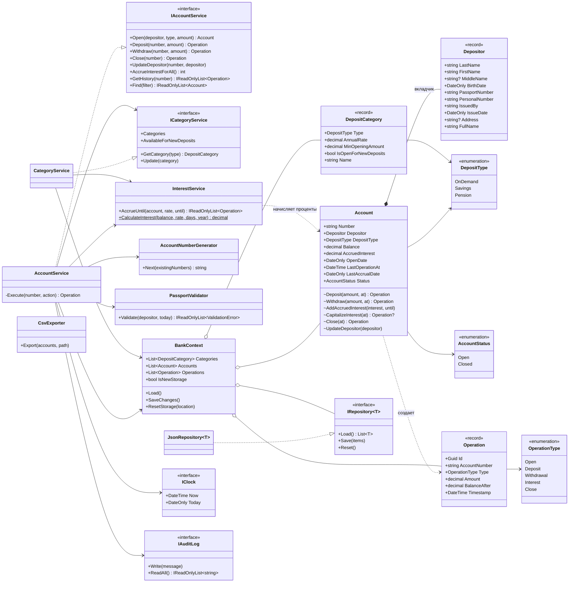
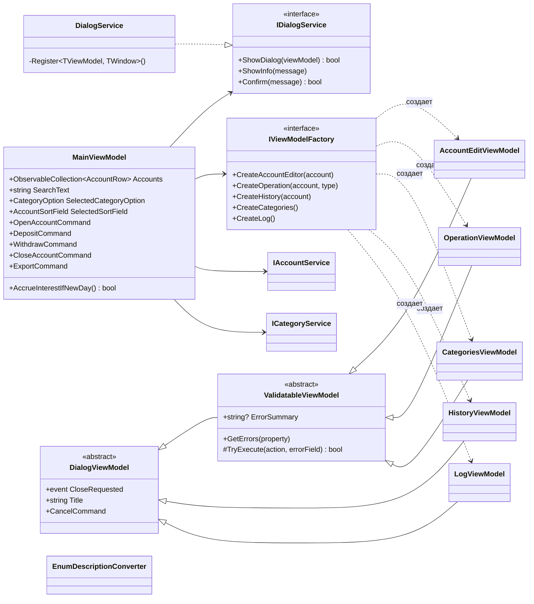

# Диаграмма классов

Диаграмма в формате Mermaid отображается на GitHub и в VS Code (расширение Markdown Preview Mermaid). Для пояснительной записки ее можно сохранить в PNG через [mermaid.live](https://mermaid.live).

Обозначения: `+` — public, `~` — internal (меняет состояние, доступно только сервисам ядра).

## Бизнес-логика (`SberProject.Core`)

## Интерфейс (`SberProject`, MVVM)

Окна (`MainWindow`, `AccountEditWindow`, `OperationWindow`, `CategoriesWindow`, `HistoryWindow`, `LogWindow`) связаны со своими моделями представления только через `DataContext` и привязки. `DialogService` находит окно по типу модели представления в своем реестре. Перечисления в окнах показываются через `EnumDescriptionConverter`. Все зависимости собираются в `App.ConfigureServices` (DI-контейнер).
